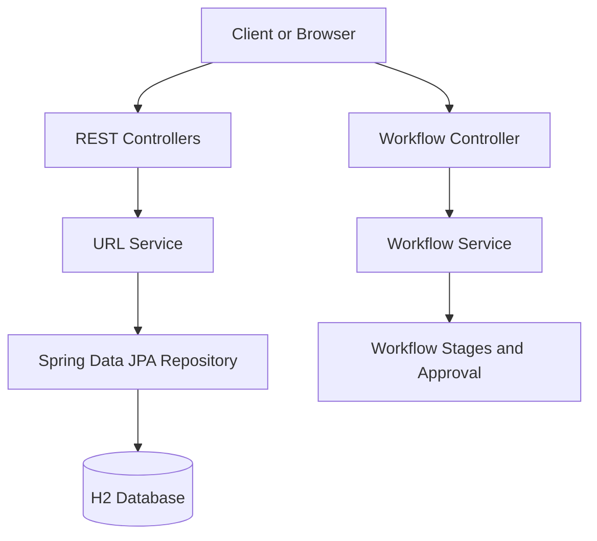

# Agentic URL Shortener

## 1. Project Overview

The Agentic URL Shortener is a Java Spring Boot application that converts long URLs into short links, redirects users to their original destinations, and tracks link clicks.

The project also contains a workflow orchestration prototype that demonstrates staged execution, approval handling, and workflow status tracking.

The application is developed as an AI-assisted engineering exercise, emphasizing API design, persistence, basic analytics, reliability, and engineering judgment.

### Objectives

- Build a working URL-shortening service.
- Provide REST APIs for creating short links and retrieving link details.
- Redirect users from short URLs to their original destinations.
- Track click counts for shortened URLs.
- Persist URL data using an embedded H2 database.
- Demonstrate workflow orchestration with approval checkpoints.
- Improve reliability and observability incrementally.
- Document architecture, testing, limitations, and design decisions.

## 2. Technology Stack

| Component | Technology |
|---|---|
| Programming language | Java 21 |
| Application framework | Spring Boot 3.5.0 |
| REST APIs | Spring Web |
| Request validation | Jakarta Bean Validation |
| Persistence | Spring Data JPA |
| Database | H2, file-based mode |
| ORM | Hibernate |
| Build tool | Maven |
| Workflow orchestration | Custom Java service |
| Development environment | IntelliJ IDEA |
| API testing | PowerShell HTTP commands |
| Automated testing | Spring Boot Test dependencies; coverage to be expanded |

## 3. Architecture Overview

The application follows a layered architecture. REST controllers handle HTTP requests, services implement business logic, repositories manage persistence, and the H2 database stores URL records.

### High-level architecture



### Main components

**1. UrlController**

Handles the primary URL-shortening APIs:

- Creates short links through `/api/links`.
- Redirects requests through `/{code}`.
- Returns link details through `/api/links/{code}`.
- Delegates business operations to `UrlService`.

**2. ShortUrlController**

Provides the alternate short-link creation endpoint:

- Accepts requests at `/api/shorten`.
- Returns the original URL, short code, and generated short URL.
- Reuses the same `UrlService` as the other URL APIs.

**3. UrlService**

Contains URL business logic:

- Validates HTTP and HTTPS URLs.
- Generates seven-character alphanumeric short codes.
- Saves URL records through `UrlRepository`.
- Retrieves URL records.
- Records clicks.

**4. Url entity**

Represents a database record with the following fields:

- `code`: short code and primary key.
- `originalUrl`: destination URL.
- `clicks`: total recorded clicks.

**5. UrlRepository**

Extends Spring Data JPA's `JpaRepository` to provide database operations.

**6. H2 database**

Stores URL records and click counts in a local file-based database. This avoids the need to install a separate database server.

**7. Workflow orchestration components**

`OrchestrationController` exposes workflow endpoints, while `WorkflowService` manages workflow runs, stages, statuses, and approval checkpoints.

The current workflow implementation is a prototype: its stage execution is simulated and is not yet integrated with actual URL-shortening operations.

## 4. URL Shortening Control Flow

### Creating a short link

1. A client sends a POST request containing the original URL.
2. The controller receives the request.
3. The service validates the URL scheme and host.
4. The service generates a seven-character code.
5. The service checks whether the code already exists.
6. The URL entity is saved to the H2 database.
7. The API returns the short code and short URL.

### Redirecting a short link

1. A browser requests `GET /{code}`.
2. The controller asks the service to record the click.
3. The service finds the URL and updates the click count.
4. The controller returns an HTTP 302 redirect to the original URL.

### Retrieving link details

1. A client calls `GET /api/links/{code}`.
2. The service retrieves the corresponding database record.
3. The API returns the short code, original URL, and click count.

## 5. API Documentation

Base URL: `http://localhost:8080`

### Create a short link

**Endpoint:** `POST /api/shorten`

Request:

```json
{
  "url": "https://www.google.com"
}
```

Successful response: HTTP 201 Created.

```json
{
  "originalUrl": "https://www.google.com",
  "shortCode": "0GIsFY7",
  "shortUrl": "http://localhost:8080/0GIsFY7"
}
```

The short code shown is an example; actual codes are generated dynamically.

### Create a short link using the alternate API

**Endpoint:** `POST /api/links`

Request:

```json
{
  "url": "https://www.google.com"
}
```

Returns the short code, original URL, and short URL.

### Redirect to the original URL

**Endpoint:** `GET /{code}`

Example:

```text
GET http://localhost:8080/0GIsFY7
```

Expected behavior: HTTP 302 redirect to the original URL and increment the click count.

### Retrieve link analytics

**Endpoint:** `GET /api/links/{code}`

Example:

```text
GET http://localhost:8080/api/links/0GIsFY7
```

The response includes the short code, original URL, and total click count.

### Workflow APIs

| Method | Endpoint | Purpose |
|---|---|---|
| POST | `/api/workflows` | Start a workflow run |
| GET | `/api/workflows/{id}` | Retrieve workflow status |
| POST | `/api/workflows/{id}/approve/{stageId}` | Approve a workflow stage |

The workflow prototype includes validation, shortening, and completion stages. Approval is required for the shortening stage. Stage execution currently simulates success rather than invoking the actual URL service.

## 6. Database Design

The application uses H2 in file-based mode.

Database URL:

```text
jdbc:h2:file:./data/shortenerdb
```

Table: `SHORT_URLS`

| Column | Type | Description |
|---|---|---|
| `CODE` | VARCHAR(7) | Primary key for each short link |
| `ORIGINAL_URL` | VARCHAR(2048) | Original destination URL |
| `CLICKS` | BIGINT | Total recorded clicks |

The database table was created successfully by Hibernate, and records and click counts were observed in the H2 console.

The file-based configuration is intended to retain data across application restarts. Restart persistence should be included in the repeatable verification procedure.

## 7. Workflow Orchestration Model

The workflow subsystem is separate from the URL service.

### Execution model

1. A workflow run is created with an identifier.
2. The service executes stages in sequence.
3. A stage may require explicit approval.
4. The run waits when an approval checkpoint is reached.
5. The approval endpoint records approval and permits execution to continue.
6. The run tracks stage and overall status.

The implementation uses an in-memory collection to store workflow runs and a thread pool to execute work.

### Current limitations

- Workflow state is not persisted in the database.
- Stage operations are simulated.
- Workflow runs are lost when the application restarts.
- The workflow has not yet been connected to real URL creation and analytics operations.

## 8. Setup Instructions

### Prerequisites

- Java Development Kit 21.
- IntelliJ IDEA.
- Maven support.
- Internet access for the initial dependency download.

A separate MySQL or PostgreSQL installation is not required.

### Configure the application

The project includes the following configuration in `src/main/resources/application.properties`:

```properties
server.port=8080
spring.application.name=agentic-url-shortener

spring.datasource.url=jdbc:h2:file:./data/shortenerdb
spring.datasource.driver-class-name=org.h2.Driver
spring.datasource.username=sa
spring.datasource.password=

spring.jpa.hibernate.ddl-auto=update
spring.jpa.show-sql=true

spring.h2.console.enabled=true
spring.h2.console.path=/h2-console
```

If Spring Boot Actuator is installed, configure health endpoint exposure separately.

### Run the application

1. Open the project in IntelliJ IDEA.
2. Reload the Maven project.
3. Ensure the project SDK is Java 21.
4. Run the main application class, `ShortenerApplication`.
5. Wait for the successful Spring Boot startup message.

The application listens on port 8080.

### Access the H2 console

Open:

`http://localhost:8080/h2-console`

Use the following settings:

- JDBC URL: `jdbc:h2:file:./data/shortenerdb`
- Username: `sa`
- Password: blank

The database files are stored relative to the application's working directory. Keep the working directory consistent when restarting the application.

## 9. Testing Approach

### Manual API tests

The current implementation has been exercised manually using PowerShell and the H2 console.

| Test | Validation |
|---|---|
| Create a short link | API returns a short code and URL |
| Inspect database | Record appears in `SHORT_URLS` |
| Redirect | Browser navigates to the original URL |
| Click analytics | Click count increases after redirect |
| Database inspection | Multiple URL records and click counts are visible |

These checks establish basic functionality, but they are not a substitute for a repeatable automated test suite.

### Recommended automated tests

1. Valid HTTP and HTTPS URL creation.
2. Rejection of blank and malformed URLs.
3. Rejection of unsupported URL schemes.
4. Redirect to the stored destination.
5. HTTP 404 for an unknown short code.
6. Correct click-count increments.
7. Persistence across application restarts.
8. Concurrent click requests without lost increments.
9. Unique-code collision handling.
10. Workflow approval and status transitions.

Run the automated test suite with:

```powershell
.\mvnw.cmd test
```

If the Maven Wrapper is not present, use:

```powershell
mvn test
```

The recommended tests above should be marked as pending until implemented and executed successfully.

## 10. Reliability and Observability

The current application has database persistence, basic input validation, and not-found handling.

Additional reliability improvements under consideration or implementation include:

- Spring Boot Actuator health checks.
- Consistent JSON error responses.
- Structured application logging.
- Atomic database updates for click counts.
- Retry handling for short-code collisions.
- Automated tests for failure cases.

Only features that have been integrated and verified should be reported as completed in a final demonstration.

A basic health endpoint, when Actuator is configured, is:

`GET /actuator/health`

## 11. Three Engineering Scenarios

These scenarios describe how the project can demonstrate engineering judgment. The scenario descriptions are not evidence that three separate end-to-end orchestration runs have already been completed.

### Scenario A: Greenfield — Create a URL Shortener

**Problem:** Build a URL-shortening service from scratch.

**Decomposition:**

1. Define the API contract.
2. Validate destination URLs.
3. Generate short codes.
4. Store URL mappings.
5. Implement redirection.
6. Add click analytics.
7. Test successful and failed requests.

**Orchestration:** Implement the components in dependency order, with API and persistence work preceding integration tests.

**Validation:** Create a link, inspect the database, follow the redirect, and verify click counts.

**Engineering decision:** Use Spring Boot and embedded H2 to produce a runnable prototype quickly without a separate database server.

### Scenario B: Brownfield — Add Persistence and Reliability

**Problem:** Improve an existing in-memory URL Shortener without breaking existing endpoints.

**Decomposition:**

1. Inspect the existing controllers and service.
2. Introduce a JPA entity and repository.
3. Migrate storage to H2.
4. Preserve the public API contracts.
5. Improve error handling and logging.
6. Address concurrent click updates.
7. Test persistence and regression behavior.

**Orchestration:** Apply changes incrementally, rebuilding and testing after each significant change.

**Validation:** Verify existing APIs, inspect database records, restart the application, and execute automated regression tests.

**Engineering decision:** Reuse the existing service and endpoints instead of introducing a separate storage implementation for each controller.

### Scenario C: Ambiguous — Improve Safety and Analytics

**Problem:** A request states, “Make links safer and improve analytics,” without defining the exact requirements.

**Decomposition:**

1. Clarify what “safer” means.
2. Define required analytics and reporting fields.
3. Identify abuse prevention and privacy requirements.
4. Prioritize features based on risk and effort.
5. Define acceptance criteria before implementation.

**Orchestration:** Ask clarifying questions, propose a small set of options, agree on acceptance criteria, implement the selected changes, and validate the outcome.

**Validation:** Test invalid destinations, malformed requests, analytics accuracy, privacy behavior, and failure handling.

**Engineering decision:** Avoid implementing speculative features before understanding the actual requirements. Possible future improvements include rate limiting, abuse detection, expiration dates, and richer analytics.

These scenarios should be demonstrated with actual implementation evidence and test results before being presented as completed scenario executions.

## 12. Limitations and Trade-offs

### Current limitations

- H2 is intended for a local prototype rather than a distributed production deployment.
- The application has basic total-click analytics, not unique visitor or time-series analytics.
- The workflow engine stores runs in memory.
- Workflow stage execution is simulated and is not integrated with URL operations.
- Automated test coverage needs to be established.
- Health monitoring and error-handling improvements must be verified if included in the final build.
- Authentication, authorization, rate limiting, and abuse prevention are not currently established as implemented features.

### Design trade-offs

**H2 versus an external database:** H2 simplifies setup and development. PostgreSQL or another production database may be more appropriate for a multi-instance deployment.

**Random codes versus deterministic codes:** Random codes avoid exposing sequential identifiers, but collisions are possible and must be handled.

**Simple click counts versus detailed analytics:** A single counter is inexpensive and easy to demonstrate, but it does not provide unique visitors, timestamps, or traffic attribution.

**Custom orchestration versus a workflow platform:** A custom service is appropriate for demonstrating stage sequencing and approval logic, but a production workflow may require durable execution, retries, observability, and recovery.

## 13. AI-Assisted Engineering Process

AI assistance was used to help develop and refine components such as:

- REST API implementation.
- H2 and JPA integration.
- URL validation and persistence.
- Workflow stages and approval handling.
- Debugging compilation and endpoint-mapping errors.
- Reliability and observability improvements.

The engineering process should include human review of generated code, compilation, API verification, database inspection, and automated testing.

AI-generated suggestions are not treated as verified until they have been run and tested in the project environment.

## 14. Current Project Status

The URL-shortening API and H2 persistence have been exercised successfully, and the H2 console has shown stored URL records and click counts.

The workflow orchestration prototype exists, but its stage execution remains simulated.

The remaining work includes completing and verifying reliability improvements, implementing automated tests, preparing final architecture and setup evidence, and demonstrating the three engineering scenarios.

**The project should be considered a working prototype in progress until the remaining tests and deliverables have been completed and verified.**
